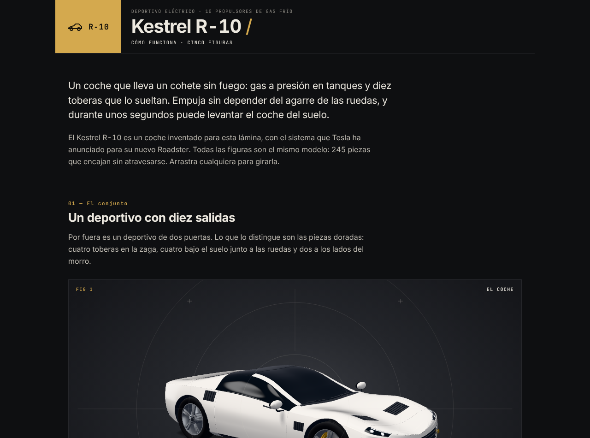
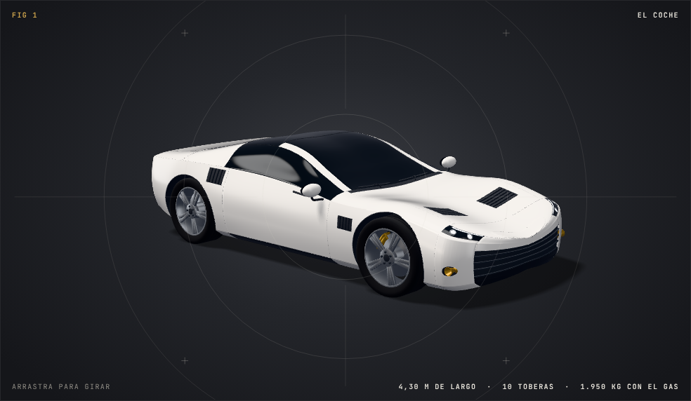
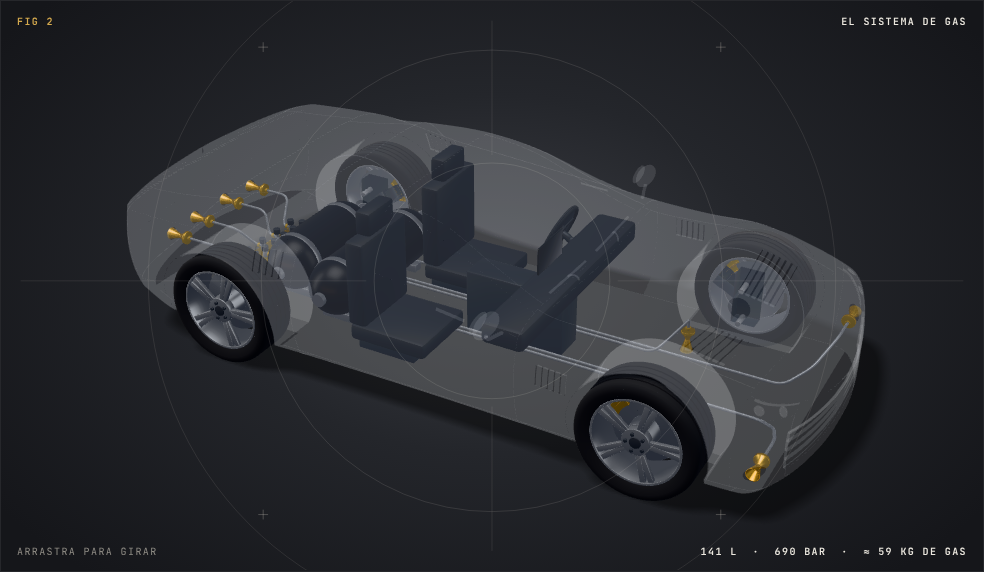
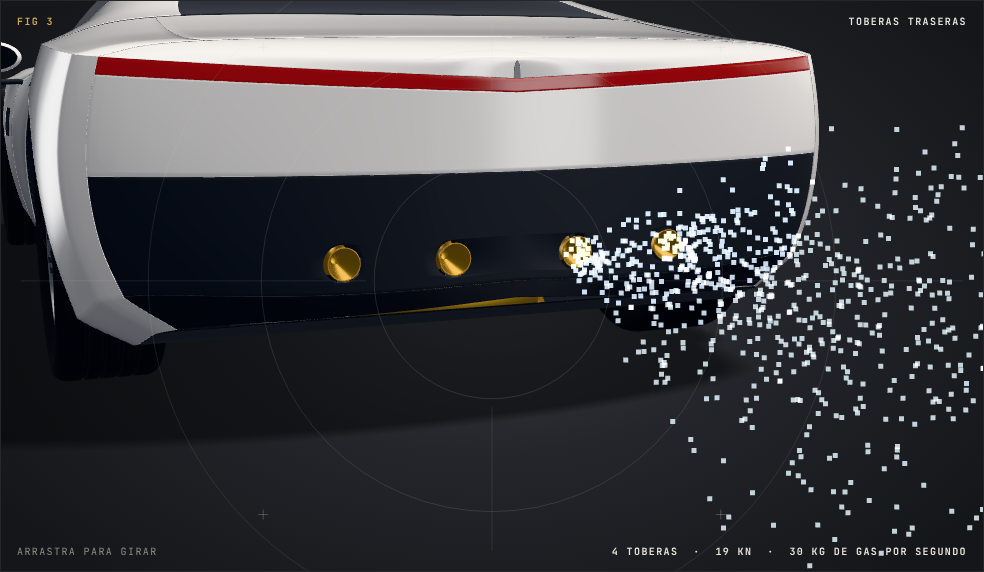
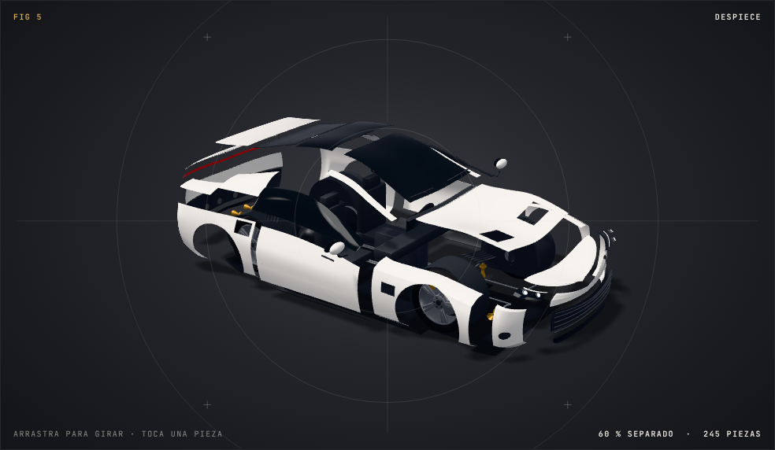
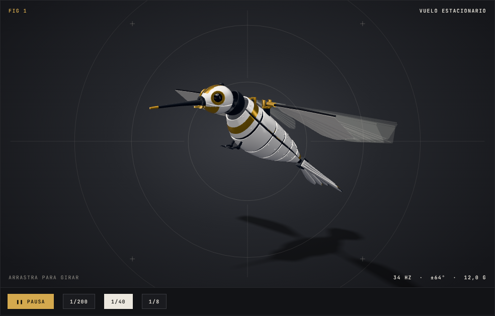

# lamina

**Ask how something works. Get a page that shows you.**

lamina is a skill for Claude Code. You name a machine; Claude models it in 3D as real parts that fit together, proves
that nothing passes through anything, and writes a short explained page where you meet the machine five or six
times: whole, opened, its mechanism alone, moving, and taken apart. Every figure is live. Drag it, slow it down,
pull the shell off, pick a part.



<p align="center"><i>One prompt, one offline HTML file. The Kestrel R-10 is a fictional sports car with ten cold-gas thrusters: 245 parts, five figures.</i></p>

## One model, seen five ways

| | |
|---|---|
|  |  |
| **The whole thing.** White and gold on a dark page, by default. | **The inside.** The body turns to glass and the system that matters stays solid. |
|  |  |
| **The mechanism, working.** With the numbers that drive it, live in the corner. | **Every part.** A slider pulls it apart; a button per part fades the rest and tells you what it does. |

## Why it is different

- **The model is real.** Parts are closed volumes built from code in Blender. Shafts go through holes, gears sit at
  the right centre distance, nothing is painted on.
- **It is checked, not eyeballed.** An audit sweeps the whole motion on the actual meshes and fails on any part that
  passes through another, floats, or meshes at the wrong distance. The first run on the example found 43
  interferences. The published one has zero.
- **It explains, it does not decorate.** A lead, a few sentences per figure, one fact in each caption, a table of the
  numbers and where they come from. One or two controls per figure, all of them real.
- **One file.** The page is a single HTML file that opens offline: the model, three.js and the fonts are inside.
- **The same model everywhere.** All the figures share one model and one WebGL renderer, so the open view, the exploded
  view and the readouts cannot disagree.

<table><tr>
<td></td>
<td></td>
</tr><tr>
<td colspan="2" align="center"><i>The example in this repo: Calypte HM-4, a fictional 12 g robotic hummingbird. 44 parts, six figures, a wing drive you can scrub by hand.</i></td>
</tr></table>

## Try it

```
git clone https://github.com/zeuscabanas/lamina ~/.claude/skills/lamina
cd ~/.claude/skills/lamina
npm install && npx playwright install chromium
```

You need Node.js 20+, and Blender 4.2+ on your PATH (or `pip install bpy`). Then ask Claude Code in plain words:

> Explícame cómo funciona un diferencial de coche con una lámina.

> Make me a lamina of a mechanical watch movement.

> How does a jet engine work? Show me.

Or build the hummingbird that ships with it:

```
python examples/colibri/model.py --audit     # or: blender -b -P examples/colibri/model.py -- --audit
node build.mjs examples/colibri              # out/colibri.html
node scripts/shots.mjs out/colibri.html      # screenshots and control checks
```

## This is a unification, and an experiment

Nothing here is a new idea. lamina joins three things other people made and tests whether they work together:

- **[teardown](https://github.com/elvarofficial/teardown)** by elvarofficial: a machine as an interactive 3D page you
  can take apart, with real numbers and one input driving everything. lamina started as a copy of it.
- **[anatomy](https://github.com/wheresryan22/anatomy)** by Ryan: the explained page of framed figures, the named
  parts you select while the rest fades, the parts list first, and an audit that must reach zero.
- **[claude-motion](https://github.com/whaleyxbt/claude-motion)** by whaleyxbt: the base teardown is built on.

The merit is theirs. What lamina adds is the glue: modelling in Blender from code, a mesh-level audit, and a page kit
that shows one audited model in several figures. Details and licences in [CREDITS.md](CREDITS.md).

It is young: two machines so far, one author. Expect rough edges, and tell me what breaks.

## What is inside

| | |
|---|---|
| `SKILL.md` | What Claude reads: the workflow, the modelling rules, the page, the look, the review. |
| `blender/tdb.py` | Modelling from code: analytic surfaces cut into panels, exact booleans, bevels, joints, GLB export with the rig inside. |
| `blender/audit.py` | The audit: interference at rest, in motion and exploded; support; gear geometry; closed volumes. |
| `kit/rig.js` | Loads the GLB and poses it with the same joint laws the audit swept. |
| `kit/page.js` | The page: framed figures on one WebGL renderer, controls, named-parts panel, dark theme. |
| `build.mjs` | One folder → one offline HTML file. |
| `scripts/shots.mjs` | Headless screenshots of every figure and a check of every control. |
| `examples/colibri/` | Calypte HM-4, a fictional 12 g robotic hummingbird: 44 parts, six figures. |

## Licence

MIT. Do what you like with it.
