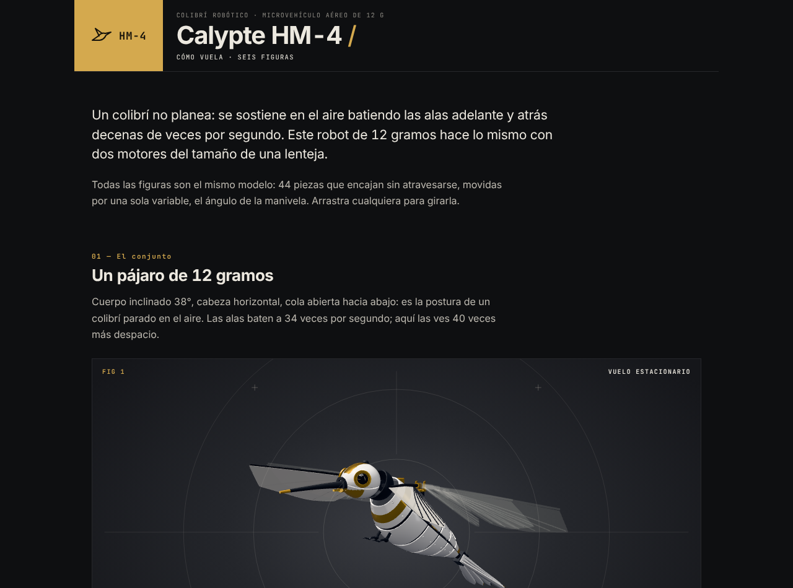
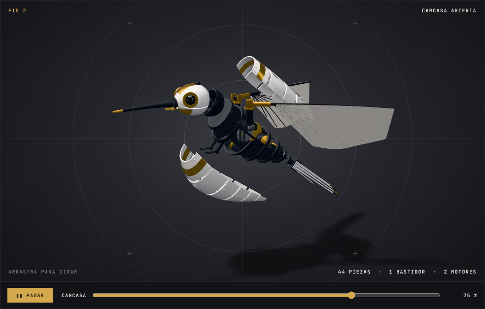
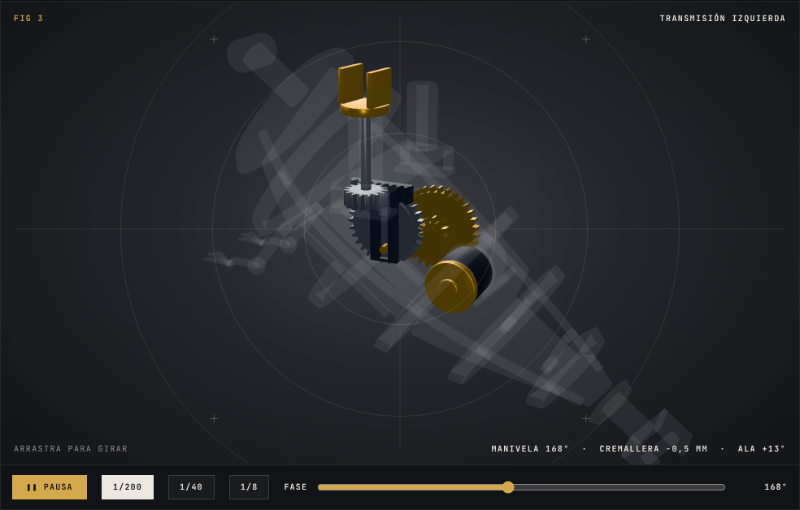
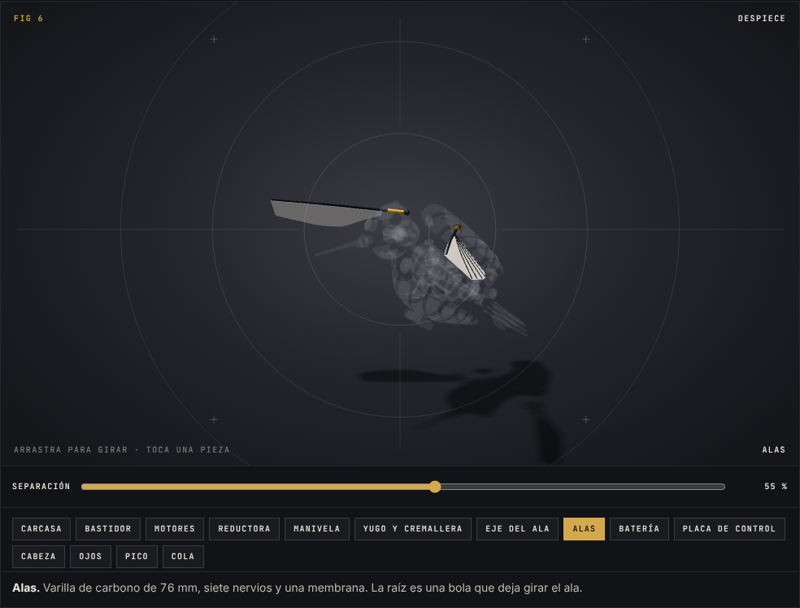

# lamina

A skill for Claude Code that explains how a machine works as a page of live 3D figures.

Ask how something works. Claude models it in Blender as real parts that fit, proves that nothing passes through
anything, and writes a short explained page where the same model appears whole, open, as a bare mechanism, in motion
and taken apart.



| | |
|---|---|
|  |  |
| The shell lifts off the airframe | The drive alone: motor, gears, crank, yoke, rack, pinion |
|  |  |
| The whole machine working | A named part selected: the rest fades |

## This is a unification, and an experiment

Nothing here is a new idea. lamina joins three things other people made and tests whether they work together:

- **[teardown](https://github.com/elvarofficial/teardown)** by elvarofficial: a machine as an interactive 3D page you
  can take apart, with real numbers and one input driving everything. lamina started as a copy of it.
- **[anatomy](https://github.com/wheresryan22/anatomy)** by Ryan: the explained page of framed figures, the named
  parts you select while the rest fades, the parts list first, and an audit that must reach zero.
- **[claude-motion](https://github.com/whaleyxbt/claude-motion)** by whaleyxbt: the base teardown is built on.

The merit is theirs. What lamina adds is the glue: modelling in Blender from code, a mesh-level audit, and a page kit
that shows one audited model in several figures. Details and licences in [CREDITS.md](CREDITS.md).

It is young. One example, one author, tested in a software renderer. Expect rough edges.

## Install

```
git clone https://github.com/zeuscabanas/lamina ~/.claude/skills/lamina
cd ~/.claude/skills/lamina
npm install && npx playwright install chromium
```

You need Node.js 20+, and Blender 4.2+ on your PATH (or `pip install bpy`).

## Use

Ask Claude Code in plain words:

> Explícame cómo funciona un diferencial de coche con una lámina.

> Hazme una página que explique un reloj mecánico por dentro.

Or build the example:

```
python examples/colibri/model.py --audit     # or: blender -b -P examples/colibri/model.py -- --audit
node build.mjs examples/colibri              # out/colibri.html
node scripts/shots.mjs out/colibri.html      # screenshots and control checks
```

## What is inside

| | |
|---|---|
| `SKILL.md` | What Claude reads: the workflow, the modelling rules, the page, the look, the review. |
| `blender/tdb.py` | Modelling from code: analytic surfaces cut into panels, exact booleans, bevels, joints, GLB export with the rig inside. |
| `blender/audit.py` | The audit: interference at rest, in motion and exploded; support; gear geometry; closed volumes. |
| `kit/rig.js` | Loads the GLB and poses it with the same joint laws the audit swept. |
| `kit/page.js` | The page: framed figures on one WebGL renderer, controls, named-parts panel, dark theme. |
| `build.mjs` | One folder → one offline HTML file. |
| `scripts/shots.mjs` | Headless screenshots of every figure and a check of every control. |
| `examples/colibri/` | Calypte HM-4, a fictional 12 g robotic hummingbird: 44 parts, six figures. |

## Licence

MIT. Do what you like with it.
